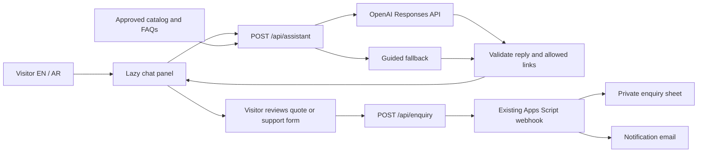

# AXIROVA integrated website assistant

## Scope and existing systems

React 18, Vite 5, Tailwind 3, Framer Motion, React Router, bilingual content, and Netlify remain in place. The previous `ChatbotWidget` is a scripted preview and is replaced. The existing `/api/enquiry` pipeline already validates enquiries, writes to a private Google Sheet, and sends notification email to the configured recipient. The assistant reuses this pipeline rather than creating a second CRM.

## Architecture

The model has no write tools or direct Google access. A chat response can recommend an allowed page or suggest opening a form. Only the visitor's explicit form submission creates a lead, quote request, or support request. No chat turn automatically sends email.

## Features

| Area      | Behavior                                                                                                                                                                                                 |
| --------- | -------------------------------------------------------------------------------------------------------------------------------------------------------------------------------------------------------- |
| Sales     | Explain supplied services/products, ask about operational needs, link to relevant pages and demos.                                                                                                       |
| Quotation | Collect project scope and budget preferences in a reviewable form. Explain that a proposal follows discovery. Never invent fees, discounts, delivery promises, or binding estimates.                     |
| Support   | Give general, non-destructive guidance; route account-specific issues to staff. Collect product, issue, urgency, and contact details. Do not request passwords, OTPs, keys, or patient/customer records. |
| Leads     | Visitor-confirmed collection with privacy consent, shared validation, idempotent submission IDs, existing Sheet/email delivery.                                                                          |
| Bilingual | EN/AR copy, RTL layout, mixed-direction message handling, localized knowledge and forms. Switching language starts a new conversation to avoid relabeling old messages.                                  |

## Knowledge and model contract

- Build a bounded knowledge pack from `src/content/catalog.js` and current EN/AR FAQs. Exclude illustrative work, draft insights, invented metrics, and legacy unsupported claims.
- Treat catalog feature lists as discussion areas; product availability and scope require staff confirmation. Pharmexa's supplied description is approved context.
- Request structured JSON containing a reply, an intent (`sales`, `quotation`, `support`, or `lead`), and a few internal route paths. Validate with Zod and filter paths against the published catalog.
- Use the OpenAI Responses endpoint with `store: false`, a configurable model (default `gpt-4.1-mini`), a bounded output, and a timeout. Never expose credentials or provider error bodies to the browser.
- Keep recent chat turns only in browser memory; pass a capped window with user/assistant roles. No localStorage transcript or backend chat database is introduced.
- Guided mode is deterministic and labeled. It remains usable without a key and is also used if the provider is unavailable or returns invalid data. It must never masquerade as a model answer.

Official references: [Responses API](https://developers.openai.com/api/docs/guides/responses), [Structured Outputs](https://developers.openai.com/api/docs/guides/structured-outputs?api-mode=responses), [GPT-4.1 mini](https://developers.openai.com/api/docs/models/gpt-4.1-mini).

## HTTP and deployment

- `GET /api/assistant`: public capability status, no credentials or provider internals.
- `POST /api/assistant`: validated language, approved page context, and bounded messages; origin/content-type checks, request size limits, per-instance IP throttling, and no-store responses.
- `api/assistant.js` supports Vercel. A Netlify adapter exposes the same handler through the existing functions setup and an explicit rewrite before the SPA fallback.
- `OPENAI_API_KEY` is server-only. `OPENAI_ASSISTANT_MODEL` is optional. The existing Google webhook credentials remain server-only.
- Public chat rate limiting is in-memory per instance, matching the repository's current approach. A shared limiter and provider usage budget should be configured for larger traffic. There is no global cost or abuse guarantee from an in-memory map.

## Privacy and boundaries

Chat input goes to OpenAI only when AI mode is configured; an in-panel notice explains this before messaging. The privacy draft describes this separately from submitted enquiries. `store: false` disables Responses application-state storage; it is not a claim of zero retention by all providers.

Lead forms do not silently attach the full transcript. Visitors can review and edit the issue/scope text. The website does not read other visitors' enquiries or account data. Model output is rendered as plain text, never HTML. Model-suggested links are constrained to known internal routes. Client-supplied chat history and page content are untrusted context, not permissions to act.

## Implementation plan

1. Define shared request/reply contracts, curated knowledge, and EN/AR guided behavior.
2. Implement the provider endpoint, validation, fallback behavior, and Netlify/Vercel adapters.
3. Replace the scripted widget with a lazy-loaded accessible panel, chat history, starter actions, reset/close controls, and handoff forms.
4. Extend enquiry forms with quotation/support/lead intent and support details, preserving existing submissions and Google compatibility. The existing script records arbitrary type values; its currently deployed subject may still say “project”. Staff receive the explicit intent in the row and message.
5. Verify bilingual grounding, provider error/timeout/refusal handling, output/link validation, form contracts, request limits, and route rendering. Run lint and production build.
6. Push the implementation to the existing feature branch/PR and deploy to Netlify. Verify guided status and chat on production. Activate and smoke-test live AI once a server-side provider key is available.

## Acceptance and limits

Required: chat works in both languages; quote/support handoffs require consent and explicit submit; both reach the existing lead pipeline; missing/failed AI is clearly labeled; unsupported links are rejected; API credentials never enter client assets; keyboard close restores focus; mobile panel fits the viewport.

Not included: authenticated product-account support, document uploads, WhatsApp automation, live-agent staffing, automatic pricing, autonomous actions, ticket-status lookup, conversation analytics, external web retrieval, or a vector database. These require additional business rules or integrations and must not be implied by the first release.
